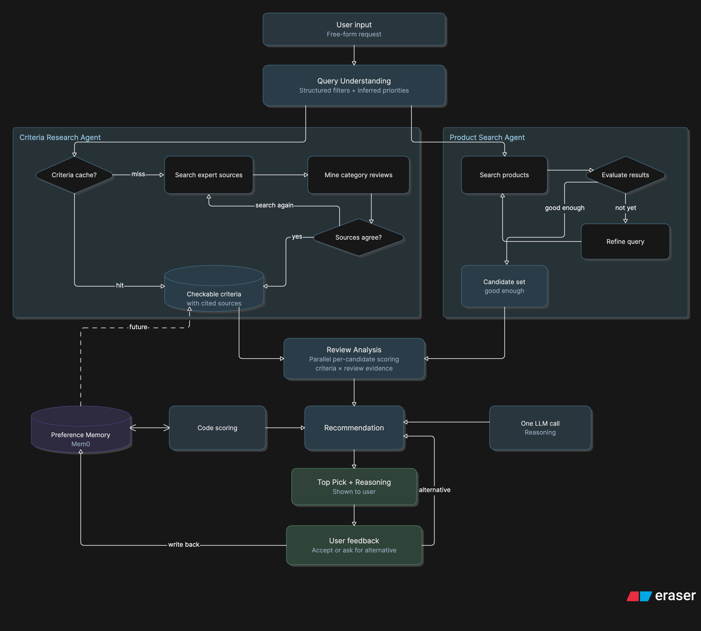

# Agentic Shopping Assistant System Design

## 1. Idea Summary

An agentic AI application that removes product research and comparison work from the user. The user gives a free-form natural language description of what they want, for example running shoes for rainy season, not white colored. The system searches across e-commerce sites such as Amazon and Flipkart, evaluates candidates against category-specific buying criteria and real review sentiment, weighs the user's learned personal preferences, and returns one clear top recommendation with reasoning, not a table the user has to compare themselves.

Core value proposition: the app makes the buying decision, it does not just aggregate research.

## 2. Feasibility Analysis

Strengths:

- Right-sized agent design: a workflow of focused LLM steps, with agents used only where the model must choose its next action (researching evidence-backed criteria for any item, and product search). Cheaper, faster and easier to debug than wrapping every step in an agent, and a stronger design-judgment story.
- Demonstrates skills that matter for AI engineering roles: tool use, retrieval, structured extraction, orchestration, state management, and handling messy real-world data such as inconsistent specs and biased reviews.
- The single decisive recommendation instead of a comparison dump framing is a strong, differentiated product angle, good for portfolio narrative.

Real challenges:

- No official free API from Amazon or Flipkart for shopper-side product search. Flipkart's public API is seller-facing only, for listings, orders, and returns.
- Workaround: third-party scraper APIs with free tiers, for example ScrapingBee around 1000 free credits, QuickCommerce API around 100 free credits, enough to build and demo without spending money.
- Self-built scraping with Playwright or BeautifulSoup is possible and more impressive if it works, but bot detection such as CAPTCHAs, IP blocks, and shifting page structure makes it a timeline risk. Treat as a stretch goal, not the version one path.
- Verdict: feasible. Recommended path is to build core agent logic against a scraper API or small static dataset first, then add real or self-built scraping later.

## 3. Architecture: a workflow with two agents

Design rule: a step is an agent only if the model decides what to do next (picks tools, observes results, loops until done). If the steps are known in advance, it is a workflow node: a function that makes an LLM call. Applying that rule gives three workflow nodes and two agents. The app must handle any item, so buying criteria cannot be hard-coded or taken from model memory; they are researched from evidence.

1. **Query Understanding (workflow node, one structured-output call):** parses the free-form description into a validated schema (Pydantic or JSON schema): category, price range, must-avoid attributes, use-case context like rainy season, and inferred priority weights such as price versus quality versus features. No tools, no loop.
2. **Criteria Research Agent (agent, cached):** works out what actually makes an item in this category good, grounded in evidence rather than model memory, which tends to produce plausible but generic lists. On a cache miss it: (a) searches expert sources such as dedicated review and testing sites, specialist forums and community threads, and extracts criteria with source links, keeping only those confirmed by at least two independent sources; (b) mines reviews across the category, grouping complaints from the negative reviews of the top 20 to 50 products to surface real failure modes, and praise from positive reviews to surface what buyers value; (c) turns every criterion into something checkable against a spec sheet or review evidence, for example waterproof rating IPX4 or higher, or sole peeling reported within 6 months; (d) searches again if sources are thin or disagree, until coverage is good enough or a budget runs out. Results are cached per normalized category with sources and an expiry date. A quick per-query step then adjusts weights for the use case, such as rainy season. Future: the user's preferences become an input, so the agent also researches preference-specific criteria, for example if the user prioritizes low weight, what counts as light for this category. Because the research path differs per item and per user, this step is a genuine agent.
3. **Product Search Agent (agent):** searches e-commerce sources via scraper API or dataset using the structured filters, then judges the results. If they are empty, too few, or off-target, it decides how to recover: relax the price range, drop a soft filter, rephrase the query, or try another source, and loops until it has a good candidate set or hits a retry budget. This observe-and-decide loop is what justifies an agent here.
4. **Review Analysis (workflow node, parallel batch extraction):** for each candidate, runs the same structured extraction over its reviews against the category criteria, for example do reviewers confirm wet-weather grip or contradict the spec sheet. Fanned out in parallel across candidates. Narrow classify or score sub-steps can use a fast small model or classifier instead of a full LLM call.
5. **Recommendation (workflow node, code scoring plus one LLM call):** ranks candidates with a deterministic weighted score over criteria fit, review-verified quality and price, using the weights from Preference Memory. An LLM call then writes the plain-language reasoning for the top pick. A backup is held in reserve and revealed only if the user asks for another option. Scoring in code keeps recommendations consistent and debuggable.

Supporting service, Preference Memory: a lightweight memory layer such as Mem0 that stores learned signals over time, price sensitivity, brand loyalty or aversion, feature prioritization such as battery life over design, risk tolerance on ratings, delivery or convenience sensitivity. Updated implicitly from what the user accepts or rejects. Read by the Recommendation step to set scoring weights, and in future by the Criteria Research Agent to add preference-specific criteria. The evidence decides what the criteria are; preferences decide how much each counts for this user. It is a lookup and update operation, so it is a service the workflow calls, not an agent.

## 4. Interaction Flow, progressive disclosure

The app never dumps a full comparison table.

1. User gives free-form description.
2. Query Understanding extracts structured filters plus inferred priorities in one structured-output call.
3. Criteria Research Agent loads evidence-backed criteria from cache, or on a miss researches them from expert sources and category-wide reviews, then adjusts weights for the use case. Runs in parallel with step 4.
4. Product Search Agent fetches candidates, refining the query and retrying until the candidate set is good enough or the retry budget runs out.
5. Review Analysis scores each candidate against the criteria using review evidence, in parallel across candidates.
6. Recommendation scores candidates in code with weights from Preference Memory, picks a top choice plus a held-back backup, and an LLM call writes the reasoning.
7. App shows only the top pick with reasoning, then asks: does this work, or would you like to see an alternative.
8. If user asks for an alternative, the backup is revealed. Whichever option the user accepts or rejects is written back to Preference Memory.

## 5. Text Flow Diagram

User Input, free-form description, down arrow to Query Understanding node, produces structured filters and inferred priorities. Branches in parallel to Criteria Research Agent, which checks the cache and on a miss loops search expert sources, mine category reviews, check agreement, search again, then caches checkable criteria with sources; and to Product Search Agent, which loops search, evaluate results, refine query, until the candidate set is good enough. Both feed Review Analysis node, per-candidate scores from criteria times review evidence, run in parallel. Down arrow to Recommendation node, code scoring connected both ways with Preference Memory service, Mem0, plus one LLM call for the reasoning. Down arrow to Top Pick plus Reasoning shown to user, down arrow to User feedback, accept or ask for alternative, written back to Preference Memory. Future: Preference Memory also feeds Criteria Research Agent.

## 6. Tech stack

The stack is chosen for learning agentic AI. The core is LangGraph because it hides nothing: state, steps, loops and branching are all written explicitly, and those ideas carry over to every other framework.

### Stack by task

| Task | Tool | Version | What you learn |
| --- | --- | --- | --- |
| Language and environment | Python 3.12, uv | V1 | Standard for AI work |
| Orchestration: steps, branches, loops | LangGraph | V1 | State, nodes, conditional edges, agent loops |
| LLM calls | LangChain model wrappers or LiteLLM; a strong model for reasoning and a small cheap model for extraction | V1 | Choosing models by cost and quality |
| Structured output | Pydantic with with\_structured\_output | V1 | Reliable, validated LLM output |
| Web search for criteria | Tavily (free tier, built for agents); Exa or Brave as alternatives | V1 | Tool calling |
| Extracting page text | Tavily extract or trafilatura | V1 | Cleaning messy web data |
| Product and review data | ScrapingBee or a similar scraper API, plus an offline JSON dataset | V1 | Handling real-world data limits |
| Running candidates in parallel | LangGraph Send API | V1 | Fan-out and fan-in (map-reduce) |
| Caching and logs | SQLite and diskcache | V1 | Keeping cost down |
| Pause and resume for Show alternative | LangGraph checkpointer (SqliteSaver) with interrupt | V1 | Persistence, human-in-the-loop |
| Tracing and debugging | LangSmith (free dev tier) or Langfuse (open source), plus LangGraph Studio | V1 | Seeing what agents actually do |
| UI | Next.js 14 (App Router, TypeScript, Tailwind) + FastAPI backend | V1 | Shipping a usable demo |
| Grouping review complaints | LLM grouping, or sentence-transformers embeddings with HDBSCAN clustering | V2 | Embeddings, clustering |
| Evaluation | LangSmith datasets and evaluators, or pytest with an LLM judge | V2 | Evals, the most in-demand agent skill |
| Preference Memory | Mem0; alternatives are LangMem or the LangGraph Store | V2 | Long-term memory |
| Tool standard | Expose search and review tools as an MCP server | V2 | The industry standard for connecting tools to agents |

### How a request flows through the stack

1. The user types a request in the Streamlit UI.
2. LangGraph starts a run and saves its state with the checkpointer.
3. Query Understanding: one LLM call returns a Pydantic object with filters and priorities.
4. Two branches run in parallel. Criteria: check the SQLite cache; on a miss, search with Tavily, extract page text, have the LLM turn it into checkable criteria, and cache them. Product search: call the scraper API (cached with diskcache), falling back to the offline dataset.
5. Review Analysis: the LangGraph Send API runs one small-model extraction per candidate, all at once.
6. Recommendation: plain Python scores the candidates (in V2 with weights from Mem0), then one LLM call writes the reasoning.
7. LangGraph interrupt pauses the run with the top pick. Clicking Show alternative resumes it from the checkpoint.
8. The whole run appears in LangSmith or Langfuse: each step, prompt, token count and cost.

The frontend runs as a separate Next.js dev server (port 3000) and proxies `/api/*` requests to the FastAPI backend (port 8000).

### Other popular frameworks, from a learning point of view

- **LangGraph:** low-level and explicit, and widely used in production. The best choice for learning and for this design.
- **CrewAI:** role-based crews of agents. Very quick to prototype, but it hides the loop, so you learn less.
- **OpenAI Agents SDK:** a few simple building blocks (agents, handoffs, guardrails). Clean, but centred on OpenAI.
- **Pydantic AI:** type-safe and good at structured output. A nice second framework to learn.
- **Microsoft Agent Framework** (successor to AutoGen): multi-agent systems built around agents talking to each other.
- **Google ADK:** best if you use Gemini and Google Cloud.
- **Claude Agent SDK:** a ready-made harness for autonomous agents that use tools.
- **LlamaIndex:** strongest when retrieval over documents is the main task.

### Learning tips

- Before touching a framework, spend one afternoon writing an agent loop by hand, about 50 lines: call the model, run whichever tool it asks for, send back the result, repeat. After that, it is obvious what LangGraph does for you.
- In V2, rebuild one agent in a second framework, for example Product Search in Pydantic AI or the OpenAI Agents SDK. Comparing the two is a strong interview answer.
- Keep tracing on from day one. Most of what you learn about agents comes from reading traces of runs that failed.

Sources: [The best AI agent frameworks in 2026, LangChain](https://www.langchain.com/resources/ai-agent-frameworks) · [Comparing open-source AI agent frameworks, Langfuse](https://langfuse.com/blog/2025-03-19-ai-agent-comparison) · [Agentic AI frameworks 2026, Uvik](https://uvik.net/blog/agentic-ai-frameworks/) · [Mem0 vs Zep vs Letta vs LangMem, Datapace](https://datapace.ai/blog/ai-agent-memory-tools-2026)

## 7. Build plan in versions

The build is split into two versions. Version 1 is a basic working prototype in 21 days: the full request-to-recommendation flow for any item, with every step in its simplest form. Version 2, up to four weeks, upgrades those steps into the full design in section 3. Paced for roughly full-time work, starting 28 September 2026.

## Version 1: working prototype, 21 days (28 Sep to 18 Oct 2026)

**What V1 includes:** Query Understanding, product search with one fixed fallback, criteria from one grounded LLM call, per-candidate review analysis, code scoring with LLM reasoning, top pick plus backup, and a simple UI. No agents yet: every step is a fixed workflow node, which keeps the prototype fast to build and easy to debug.

**Left for V2:** the Criteria Research and Product Search agents, the criteria test set and evaluation, Preference Memory, and portfolio polish.

### V1 Week 1 (28 Sep to 4 Oct): foundations and search

**Goal:** any free-form request returns a list of real candidate products.

- [ ] Set up the project: Python, LangGraph, Pydantic, LLM provider keys, config, and basic tracing (LangSmith or JSON logs).
- [ ] Define the shared graph state: raw query, parsed filters, priorities, criteria, candidates, per-candidate evidence, recommendation, backup.
- [ ] Sign up for a scraper API free tier and write a search client that returns a normalized Product record: title, price, rating, rating count, key specs, URL, source.
- [ ] Cache every raw API response to disk so repeated runs cost no credits.
- [ ] Build a small offline dataset (about 30 products with reviews for each of 3 categories) as a fallback when the API fails or credits run out.
- [ ] Build the Query Understanding node: Pydantic schema (category, price range, must-have, must-avoid, use-case context, priority weights), prompt, validation, and one retry on invalid output.
- [ ] Build Product Search as a fixed call with one fixed fallback: if too few results come back, relax the price range and drop soft filters once, then stop.
- [ ] Wire the graph (input, Query Understanding, Product Search, printed results) and run 20 varied test queries.

**Done when:** a command-line run returns relevant candidates for at least 17 of the 20 test queries.

### V1 Week 2 (5 Oct to 11 Oct): criteria and review analysis

**Goal:** every candidate carries evidence for or against the criteria that matter for its category.

- [ ] Build Criteria v1 as a workflow node: one web search for buying guides, then one LLM call that returns 5 to 8 checkable criteria, each with why it matters, how to check it, and the source URLs used.
- [ ] Adjust criterion weights for the use case in the same call, for example rainy season raises wet grip.
- [ ] Normalize category names and cache criteria in a JSON file or SQLite so repeat categories cost nothing.
- [ ] Fetch reviews for the top 8 candidates only, to save API credits.
- [ ] Build Review Analysis: for each candidate and each criterion, extract confirmed, contradicted or not mentioned, with a supporting quote. Run candidates in parallel.
- [ ] Spot-check the criteria for 5 categories against a trusted buying guide and note the gaps for V2.

**Done when:** for any test query, each candidate has per-criterion evidence with quotes, and the criteria look sensible on the 5 spot-checked categories.

### V1 Week 3 (12 Oct to 18 Oct): recommendation, UI, prototype ready

**Goal:** a demoable prototype that makes one clear recommendation.

- [ ] Build Recommendation scoring in code: remove must-avoid violations, then a weighted score over criteria evidence, price and rating, using the priorities from Query Understanding.
- [ ] Pick the top product plus a held-back backup, and have one LLM call write the reasoning, citing review evidence.
- [ ] Add conditional edges: no candidates found (clear message to the user), and the show-alternative path that reveals the backup.
- [ ] Build the UI: FastAPI backend (POST /search, GET /search/{id}/alternative) + Next.js frontend with search input, top-pick card with reasoning and source links, Accept and Show Alternative buttons.
- [ ] Log every accept and alternative request to a file. V2 uses this log to seed Preference Memory.
- [ ] Handle failures: API errors fall back to the offline dataset, and slow steps have timeouts.
- [ ] Run 15 end-to-end queries across varied items, fix what breaks, and write a short README with the architecture diagram.

**Done when:** any request in the UI returns a single top pick with evidence-backed reasoning, Show alternative reveals the backup, and the 15 test queries run without errors.

## Version 2: full design, up to four weeks

**Goal:** turn the prototype into the full architecture in section 3: two agents, measured criteria accuracy, personalization, and a portfolio-ready project.

### V2 Week 1: Criteria Research Agent and evaluation

- [ ] Build the criteria test set from section 8: 20 to 30 varied categories with reference criteria from trusted buying guides.
- [ ] Measure V1 criteria against it first, as a baseline.
- [ ] Upgrade Criteria into an agent: search several expert sources, mine complaints and praise across the category's top 20 to 50 products, keep criteria backed by at least two sources or a strong review signal, and search again when sources are thin or disagree.
- [ ] Add loop control (maximum search rounds, token budget) and log every decision.
- [ ] Add cache expiry dates, and store sources with each criterion.
- [ ] Write the evaluation script (recall and precision, LLM judge plus hand spot-checks) and iterate until recall reaches about 80 percent.

**Done when:** the agent beats the V1 baseline on the test set, and the numbers are recorded in the repo.

### V2 Week 2: Product Search Agent and stronger review analysis

- [ ] Upgrade Product Search into an agent: evaluate results (count, relevance, must-avoid violations), choose a recovery action (relax price, drop a soft filter, rephrase, switch source), and retry within a budget.
- [ ] Run Criteria Research and Product Search in parallel in the graph.
- [ ] Use a small fast model for Review Analysis classification, and down-weight products with few or suspicious reviews.
- [ ] Add a conditional edge for conflicting signals, such as a high star rating but reviews that contradict key criteria.
- [ ] Rerun the 15 end-to-end queries and compare the results with V1.

**Done when:** queries that returned empty or poor results in V1 now recover automatically, and end-to-end results are at least as good as V1.

### V2 Week 3: Preference Memory

- [ ] Integrate Mem0 with preference signals (price sensitivity, brand likes and dislikes, feature priorities, rating risk tolerance, delivery sensitivity) and cold-start defaults.
- [ ] Seed it from the V1 accept and alternative log, then write back on every accept, reject or alternative request.
- [ ] Read preferences into the Recommendation scoring weights.
- [ ] Feed preferences into the Criteria Research Agent so it also researches preference-specific criteria, for example what counts as light for a user who prioritizes low weight.
- [ ] Test personalization: two simulated users with different histories should get different top picks for the same query. Add matching preference cases to the criteria test set.

**Done when:** recommendations change sensibly with user history, and preference-specific criteria appear for users who have them.

### V2 Week 4: hardening and portfolio

- [ ] Measure cost and latency per query, and add caching wherever requests repeat.
- [ ] Visualize runs in LangGraph Studio or LangSmith so both agent loops are visible.
- [ ] Improve the UI: show the key evidence behind the pick, and a simple view of what the app has learned about the user.
- [ ] Write the full README: architecture diagram, why only two steps are agents, criteria evaluation numbers, data-access challenges such as anti-scraping and rate limits.
- [ ] Record a 2 to 3 minute demo video.

**Done when:** the app runs from a single command or a hosted link, the README tells the design story, and the demo video is recorded.

### Later, beyond V2

- Replace the scraper API with self-built scraping using Playwright.
- Add more sources and compare prices for the same product across sites.

## 8. Evaluating criteria accuracy

Accurate criteria are the foundation of a good recommendation, so measure them rather than trust them.

- Build a test set of 20 to 30 varied categories, from common items like earbuds to niche ones like trekking poles.
- For each, record the criteria that trusted buying guides agree on. This is the reference answer.
- Run the Criteria Research Agent and measure recall (how many reference criteria it found) and precision (how many of its criteria are real rather than noise). Also check that every criterion has a source and is checkable.
- Rerun after every change to prompts, sources or review mining, and track the numbers over time.
- Future: once user preferences feed the agent, add test cases with a sample preference profile and check that preference-specific criteria appear.
